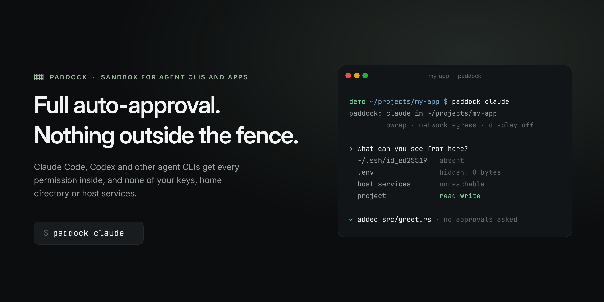
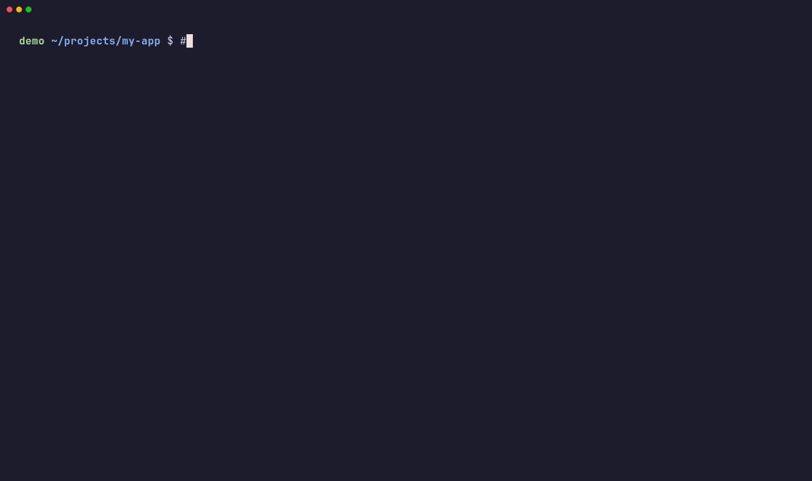

# paddock

<p align="center">
  
</p>

<p align="center">
  <a href="LICENSE"></a>
</p>

paddock runs coding agents with full auto-approval inside a sandbox: terminal harnesses such as Claude Code, Codex, Antigravity, Gemini CLI, opencode and Copilot CLI, and desktop apps such as ChatGPT, Claude Desktop and VS Code. The sandbox contains only what the agent needs: the project, the harness, a private home directory, and package caches. Everything else on the host is absent from the file system. The agent cannot read it, so you do not need to approve each command.

```sh
cd ~/src/my-app
paddock claude
```

> [!WARNING]
> By default, the sandbox inherits your host environment variables, and the agent can read every token in them. paddock prints the names of the variables that look like secrets. High-privilege cloud credentials (AWS, Azure, Google Cloud, Vault, Terraform and others) are not passed unless you name them in `[env] pass`. To drop single variables, hide them. paddock saves the list in `~/.config/paddock/config.toml`.

```sh
paddock env hide GITHUB_TOKEN OPENAI_API_KEY
paddock env unhide OPENAI_API_KEY
paddock env show
```

To pass only an allowlist, run `paddock claude --env clean`, or set `[env] inherit = false`. To drop single variables, run `paddock env hide NAME`.

## See it

`paddock claude` opens Claude Code's own TUI, as you know it, with full auto-approval. Inside the paddock, the agent cannot see the SSH key on the machine, the `.env` in the project is empty for it, and it still runs commands and writes code without asking for approval.

<p align="center">
  
</p>

## Why

Harnesses tie two settings together in the wrong direction. Their built-in sandboxes restrict commands, so builds and tests fail for missing tools. Their auto-approval modes turn that sandbox off, so commands run on the host. The help text of Codex says that its bypass flag is "intended solely for running in environments that are externally sandboxed". paddock is that external sandbox.

paddock moves the boundary from "which commands can run" to "which files exist". Inside the boundary, the agent has every tool and approves itself. The boundary is kernel namespaces, which the agent cannot negotiate with.

## Install

paddock is a Rust command and an Omarchy bar plugin in one repository. Clone the repository, and run the installer from its root. It installs the system packages, builds paddock, and runs `paddock doctor`.

```sh
git clone https://github.com/harnessix/omarchy-paddock
cd omarchy-paddock
bin/install
```

Without a Rust toolchain, use the prebuilt binary from the [latest release](https://github.com/harnessix/omarchy-paddock/releases/latest). It is one file. Check its checksum, copy it to `~/.local/bin`, and run `paddock doctor`, which prints the command that installs the system packages below:

```sh
sha256sum -c paddock-*-x86_64-linux.tar.gz.sha256
tar -xzf paddock-*-x86_64-linux.tar.gz
install -m 755 paddock-*-x86_64-linux/paddock ~/.local/bin/paddock
paddock doctor
```

On Arch Linux, the installer installs a package with makepkg. It also knows apt and dnf, and then copies the binary to `~/.local/bin`; that path is best effort and is not tested on every release (see [Support scope](#support-scope)). Use `bin/install --minimal` to skip the desktop packages.

| Package | Needed for |
| :--- | :--- |
| git | project and worktree detection (required) |
| bubblewrap | the default backend (required) |
| passt | outbound network on the bwrap backend (required) |
| iproute2 | hiding host addresses on the bwrap backend (required) |
| weston | displays for desktop projects, and `paddock-screenshot` |
| xwayland | X11 apps on the private display |
| dbus | a private session bus for desktop apps |
| docker or podman | the container backend |
| mise | per-project toolchains from `mise.toml` |
| gnome-keyring | a private keyring for app sandboxes and for harnesses that need one, such as Copilot CLI |

`paddock doctor` prints the same list with the state of each package and the install command for your distribution.

To add the bar widget on Omarchy, point `omarchy plugin add` at this repository:

```sh
omarchy plugin add https://github.com/harnessix/omarchy-paddock --enable
```

The widget lists running sandboxes with their backend, network, display and login. Press Enter on a sandbox to go to the terminal that runs it (Hyprland). The row actions open the project folder, copy its path, show the display window of a sandbox in `window` mode, and stop the sandbox after a second press. The New button starts a sandbox in two steps: pick a recent project, then a harness that is installed on this machine, and paddock opens a terminal that runs it. The Checks button runs `paddock doctor`. Every action has a key, and the panel footer lists them.

### Let your agent set it up

paddock ships two agent skills. Install them with the [skills](https://github.com/vercel-labs/skills) command, which supports Claude Code, Codex, Copilot, Gemini CLI, opencode and other agents:

```sh
npx skills add harnessix/omarchy-paddock
```

- `paddock` is for an agent on the host. It covers install, `paddock doctor`, shell commands, launchers, configuration and removal. It tells the agent to leave every change that weakens the sandbox to you: approvals, `[host]` modes set to `allow`, host network, and agent approvers.
- `paddock-host` is for an agent inside a sandbox. It explains how to ask the host for a screenshot, a file or a command, and how `git push` and `gh` work there. `paddock skill install` installs this one too.

Then ask your agent, for example: "Install paddock and make the sandbox the default for my agents."

## Remove

1. Remove the bar widget:

   ```sh
   omarchy plugin remove harnessix.paddock
   ```

2. If you turned them on, remove the shell commands and the launchers. Do this before you remove the command:

   ```sh
   paddock shims remove
   paddock launchers remove
   ```

   If you forget this step, nothing breaks. The line in `~/.bashrc` runs only when its script exists, and each command falls back to the real program when paddock is gone. The launcher entries stay in the menu until you delete them.

3. Remove the command. If you installed the Arch package (`bin/install` does this on Arch Linux), run `sudo pacman -R omarchy-paddock`. Otherwise, delete `~/.local/bin/paddock`.

4. Optional: delete the data that paddock keeps. These directories hold the sandbox homes, isolated logins, shared caches, worktrees and settings. Your own logins and files are not in them.

   ```sh
   rm -rf ~/.local/share/paddock ~/.cache/paddock ~/.local/state/paddock ~/.config/paddock
   ```

   If you set `XDG_DATA_HOME`, `XDG_CACHE_HOME`, `XDG_STATE_HOME` or `XDG_CONFIG_HOME`, the directories are under those paths instead.

5. Optional: if you used the docker or podman backend, remove the images: `docker image rm $(docker image ls -q paddock-base)`.

paddock does not change any file outside these directories, except the files that you name in `paddock env hide` (in `~/.config/paddock/config.toml`), the git worktrees that `--worktree` creates, and the files that `paddock shims install` and `paddock launchers install` change. Step 2 undoes those two. To remove a worktree, use the commands that paddock prints when the sandbox exits.

## Use

```sh
paddock claude                 # Claude Code in the current project
paddock codex ~/src/api        # Codex in another project
paddock claude -- -p "fix the failing test"   # arguments after -- go to the harness
paddock claude --worktree      # work on a new branch in a new worktree, review the diff at exit
paddock shell claude           # a shell in the sandbox that claude gets
paddock explain claude         # every mount, variable and rule, and why it is there
paddock ps                     # running sandboxes
paddock files                  # files a sandbox saved outside the project
paddock doctor                 # dependencies, backends, located harnesses
paddock doctor --escape        # try to escape, and report each attempt
paddock mcp claude             # MCP servers, and whether each runs in the sandbox
paddock env show               # which host variables pass, by name
```

A sandbox uses your existing login of the harness. See [Logins and MCP](#logins-and-mcp) for a separate login.

## What the sandbox contains

| Inside the sandbox | Source on the host |
| :--- | :--- |
| The project (git root), read-write | the project directory |
| `.git/hooks`, `.git/config`, read-only | the same files. Git runs them on the host. |
| `$HOME`, read-write | a private directory per harness, login and project, under `$XDG_DATA_HOME/paddock/homes` |
| Credential files of the harness | copied from your home directory, or from an isolated store |
| Harness settings and skills, read-only | the files that the harness profile lists in `import_ro` |
| The harness program, read-only | its install directory, found through PATH or mise |
| Package caches (cargo, npm, uv, go, mise) | shared caches under `$XDG_CACHE_HOME/paddock/shared` |
| `/usr`, `/etc`, read-only (bwrap backend) | the host system |

The sandbox never contains your real home directory, `~/.ssh`, `~/.gnupg`, cloud credentials, browser profiles, the container runtime socket, or the session bus. Files with credential-shaped names in the project (`.env`, `*.pem`, `*.key`) are hidden. The policy engine refuses any configuration that breaks these rules, and names the line that asked for it.

## Files outside the project

The project is shared with the host, so the agent's changes there are already yours. A file that the agent saves anywhere else, for example to `~/Desktop` or `~/Downloads`, stays in the private sandbox home. You do not see it until you recover it.

`paddock files` lists these files for each sandbox, also after the sandbox exits. It also shows the commits and the changed paths in the project since the sandbox started.

```sh
paddock files                                 # every sandbox that has files
paddock files claude-app-1a2b3c               # one sandbox
paddock recover claude-app-1a2b3c Desktop/report.pdf          # to ~/Desktop/report.pdf
paddock recover claude-app-1a2b3c --all --to ~/Inbox
paddock discard claude-app-1a2b3c Downloads/setup.zip
```

`paddock recover` copies the file to the host, then deletes the sandbox copy. Add `--keep` to keep it. The rules:

- A recovered file never replaces a file. If the name is taken, the file gets a new name, such as `report (1).pdf`.
- paddock never writes into a hidden path of your home, such as `~/.ssh` or `~/.config`, into its own directories, or into system directories. It refuses, even when you ask for it.
- paddock copies regular files only. It skips symlinks, devices and pipes, and it never follows a symlink in the sandbox home. A recovered file is never executable: paddock drops the execute bits, so one click on the host cannot run it.

The Omarchy panel lists the same files. Press Enter on a file to recover it. When a sandbox saves a new file, a desktop notification tells you. The notification does not take the keyboard.

paddock looks in the recovery folders only. The defaults are `Desktop`, `Documents`, `Downloads`, `Pictures`, `Videos` and `Music`, with all their subfolders. A folder of your host that has another name, set in `~/.config/user-dirs.dirs`, is the target. Change the folders in `~/.config/paddock/config.toml`. A project `paddock.toml` cannot change them, because the agent can edit it.

```toml
[recovery]
folders = ["Desktop", "Downloads", "out"]
ignore = ["*.desktop", "*.part", "*.tmp"]   # never listed
```

By default, paddock ignores `*.desktop` launchers, because they can run commands when you open them, and partial or lock files.

## Network

| Mode | Behavior |
| :--- | :--- |
| `egress` (default) | Internet access that leaves the same way as host traffic. Host services and the LAN are not reachable. |
| `none` | No network. |
| `host` | The host network namespace. Host-local services are reachable. Needs approval in `paddock.toml`. |

Many users depend on a system proxy or a TUN device for a stable exit address, and an account can be flagged when that address changes. So paddock never gives a sandbox a bridged network.

On the bwrap backend, `egress` uses pasta. pasta makes each outbound connection as an ordinary socket of a host process, so the connection follows the host routes, the TUN device, and the host DNS resolver. If the host sets `HTTPS_PROXY` or a similar variable, the sandbox gets the same value, and a proxy on the host loopback is the one loopback port that the sandbox can reach. paddock turns off the other port forwarding of pasta, and makes every address of the host unreachable inside the sandbox, so services on the host stay hidden.

The LAN is blocked too. A sandbox cannot reach private and link-local networks: 10.0.0.0/8, 172.16.0.0/12, 192.168.0.0/16, 169.254.0.0/16, 100.64.0.0/10 (VPN peers such as Tailscale), and the IPv6 ranges fc00::/7 and fe80::/10. So your router, NAS, printers and other machines stay out of reach. A host proxy on the LAN stays reachable, because all traffic goes through it. To let a project reach the LAN, set this in `paddock.toml` (it needs your approval) or in `~/.config/paddock/config.toml`:

```toml
[network]
lan = true
```

On the docker and podman backends, the container has no network interface. Its only way out is a Unix socket to a proxy in the paddock process on the host. That proxy connects like a host program, through the host proxy variables or directly. It refuses connections to the host itself. Programs that ignore `HTTPS_PROXY` get no network, so no traffic leaves by another path.

`paddock doctor --escape --network egress --online` checks all of this: DNS and HTTPS work, and the host loopback, the other host addresses, and direct connections that bypass the proxy do not.

## Logins and MCP

By default, a sandbox uses your existing login (auth mode `shared`). paddock copies the credential files of the harness from your home directory into the sandbox at start. If the harness refreshes a token in the sandbox, paddock writes it back when the sandbox exits. If the file also changed on the host in the meantime, the host version stays, and paddock tells you.

Some harnesses keep their login in the system keyring. Copilot CLI is one of them. Its sandbox gets a private keyring of its own (gnome-keyring, on a private session bus), encrypted with a password that paddock keeps on the host. The sandbox cannot reach your host keyring, and your host keyring does not see the sandbox's login. So you log in once inside the sandbox, and the login stays for later runs.

For a separate account, use an isolated login. The sandbox then starts logged out, and you log in inside it. Each name is a separate store.

```sh
paddock claude --auth isolated          # one separate login
paddock claude --auth isolated:work     # another one, named "work"
paddock auth import claude --auth isolated:work   # start it from a copy of your login
```

MCP servers come from the same configuration as on the host, and MCP OAuth tokens come with the login. paddock mounts the runtime of each stdio server read-only when its command is in a tool install directory (system directories, mise, node_modules, uv, `~/.local/bin`). A server that needs other host files, or a server on a host loopback port, stays off until you allow it:

```sh
paddock mcp claude     # each server, and whether it runs in the sandbox
```

```toml
# ~/.config/paddock/config.toml or the project paddock.toml
[mcp]
allow = ["my-server"]   # mount the host paths that this server needs, read-only

[network]
host_ports = [8765]     # a local MCP server on the host loopback
```

Some harnesses can keep MCP tokens in the system keyring instead of a file. The sandbox cannot reach the keyring. For Codex, set `mcp_oauth_credentials_store = "file"` to share the tokens.

## Environment variables

By default, the sandbox gets the host environment. The first time in a project, and each time the list changes, paddock prints how many variables it passed and the names of the ones that look like secrets. High-privilege cloud and infrastructure credentials are not passed either: AWS keys and session tokens, Azure client secrets, `GOOGLE_APPLICATION_CREDENTIALS`, Cloudflare, DigitalOcean and Hetzner tokens, `VAULT_TOKEN`, Terraform `TF_TOKEN_*`, forge tokens such as `GH_TOKEN` and `GITLAB_TOKEN`, and similar. They can create, delete or bill resources far beyond the project. The notice names the ones that it dropped, and `paddock env show` lists them. To pass one, name it in `[env] pass`. Variables that name a host socket or a control channel (`SSH_AUTH_SOCK`, `DBUS_SESSION_BUS_ADDRESS`, `HYPRLAND_INSTANCE_SIGNATURE`, `DOCKER_HOST`, terminal multiplexer sockets, the Claude app's `CLAUDE_CODE_MESSAGING_*`) are never passed, and the sandbox sets `HOME`, `PATH` and `TMPDIR` itself.

To pass only an allowlist (terminal, locale, the variables of the harness profile, `[env] pass`, and the host proxy), use `--env clean`, or set this in `~/.config/paddock/config.toml`:

```toml
[env]
inherit = false
pass = ["MY_TOOL_TOKEN"]
```

## Desktop projects

The sandbox has the libraries for desktop apps: the bwrap backend sees the host `/usr`, and the docker backend installs them in its image. Access to the display is the risk. A client of the host compositor can capture the screen and read the clipboard, and on wlroots compositors it can type into other windows. paddock has four display modes:

| Mode | What the agent gets |
| :--- | :--- |
| `off` | No display. The default for projects that are not desktop projects. |
| `headless` | A private compositor inside the sandbox, with Xwayland. The agent runs the app and inspects it with `paddock-screenshot`. Nothing on your desktop is reachable. paddock turns this mode on when it finds a desktop project (Tauri, Electron, GTK, Qt, egui, iced, Flutter and others). |
| `window` | A nested compositor that runs on your desktop as one window. You watch the app, and the agent sees only that window. |
| `host` | Your real compositor socket. Use it only when you must. Needs approval. |

```sh
paddock claude --gui window
```

Add `--gpu` to bind the GPU render nodes. Without it, apps render in software.

## Host requests

Sometimes the agent needs one thing from your computer: a screenshot of the real screen, one command on the host, or one file outside the project. paddock does not open the sandbox for that. The agent asks with `paddock-host`, you decide on the host, and paddock does the work on the host.

| Capability | What the host does | Default |
| :--- | :--- | :--- |
| `screenshot` | Captures the screen, one output or the focused window | ask |
| `exec` | Runs one command in the project folder, without a shell | ask, and never allow |
| `fetch` | Copies one host file or folder into the project, at most 64 MiB | ask |
| `clipboard-read`, `clipboard-write` | Reads or sets the host clipboard | ask |
| `open-url` | Opens an http or https link in your browser, for example a harness login page | ask |
| `notify` | Shows a desktop notification | allow |
| `git-push` | Pushes commits to a remote of the project, with your credentials | ask |
| `forge` | Runs a fixed set of `gh` commands on the project's repository, with your login | reads allow, writes ask |

A request that asks waits for your answer for up to two minutes. You can answer in three places, and the first answer wins:

- An approval card appears at the top of the screen as soon as a request arrives, without opening the panel. It shows the question, exactly what will run and in which folder, the reason that the agent gave, and the time left. Click No, Yes once or Yes for this session. The card never takes the keyboard when it appears, so typing in another window cannot answer it. To answer with the keyboard, bind a key to `omarchy-shell harnessix.paddock.approvals keys`: the card then starts on No.
- The bar widget turns red and shows the number of waiting requests. The panel lists them and the most recent answers, including the ones that the agent approver gave.
- Without the Omarchy plugin, a desktop notification offers the same three answers.
- In a terminal, `paddock approvals` lists the requests, and `paddock approvals answer <id> once|session|deny` answers one.

Some rules hold whatever your configuration says. `exec` is never allowed without asking, and "Allow for this session" covers only the identical command line. `fetch` refuses the protected paths (`~/.ssh`, `~/.gnupg`, cloud credentials and the others), even if you approve. Results that are files go to `.paddock/inbox/` in the project, which git ignores.

Set the mode of each capability in `~/.config/paddock/config.toml`. A project `paddock.toml` cannot change these modes, because the agent can edit it.

```toml
[host]
screenshot = "allow"   # deny | ask | allow
clipboard-read = "deny"
wait = 60              # seconds to wait for an answer
```

### Push and pull requests

The sandbox has no SSH key, no git credential helper and no `gh` login. paddock also drops `GH_TOKEN`, `GITHUB_TOKEN`, `GITLAB_TOKEN` and similar variables from the inherited environment. The agent still runs plain `git push` and `gh pr create`. The host does the work with your own credentials, and the token never enters the sandbox.

For `git push`, the sandbox git configuration sends the push to paddock on the host. The approval card shows the remote URL, each local and remote branch, the commits (at most 20) and whether it is a force push. The host pushes from a scratch repository that has no configuration and no hooks of its own. A file that the agent writes in `.git` cannot run a program on the host.

- Force pushes, branch deletions and pushes to the default branch ask every time. "Allow for this session" is not offered for them.
- "Allow for this session" covers one remote and one branch.
- paddock reads the remotes when the sandbox starts. Inside the sandbox, `.git/config` is read-only. If the agent names another remote, for example with `git -c`, the card marks it as new and asks every time. The host always pushes to the URL that a remote had at the start.
- Hooks never run on the host, not even `pre-push`.

For `gh`, only these commands exist: `pr create`, `pr view`, `pr list`, `pr checks`, `pr diff`, `pr comment`, `issue view`, `issue list`, `issue comment`, `run view`, `run watch`, `run list` and `repo view`. The commands that only read run without a question. `pr create` and the comment commands ask. `--repo` must name the repository of one of the project's remotes, and paddock adds it when the agent leaves it out. paddock refuses `gh api`, `gh auth`, `gh secret` and every other command. It also refuses the flags that read a host file or open a program on the host, such as `--web` and `--editor`. The sandbox reads `--body-file` itself and sends the text. `gh` must be installed and logged in on the host.

To make reads ask too, or to turn either capability off, set it in `[host]`, for example `forge = "deny"`. `forge = "allow"` also allows the write commands without a question. `git-push = "allow"` allows ordinary pushes, but force pushes, pushes to the default branch and pushes to a new remote still ask.

`paddock log` shows every request with its decision and result. To teach agents the client, run `paddock skill install`: it copies a short skill into the skill folders of your harnesses. Inside a sandbox, `paddock-host --help` is the full reference.

You can let an agent on the host answer requests for you (`paddock approver`). paddock trusts that setting only from a root-owned file (`sudo paddock approver enable --system`) or from a file signed with a password that you type when a sandbox starts, so that a process on your computer cannot turn it on for itself. The agent approver can only answer the capabilities that you list, the rules above still hold, and if it does not answer clearly, the request comes to you.

## App mode

Desktop agent apps run in a sandbox too: ChatGPT with Codex, Claude Desktop, VS Code, and flatpak apps. They get the same file, git, secrets, environment and network rules as a terminal harness, and their windows are normal windows on your desktop.

<p align="center">
  
</p>

```sh
paddock app list                          # the apps paddock knows, and their launcher entries
paddock app run claude-desktop ~/src/api  # run an app with one or more workspace folders
paddock app install chatgpt-desktop ~/src/web   # add a launcher entry that runs it in paddock
paddock app uninstall chatgpt-desktop
```

The app sees only the folders that you give it, from the command line or from `[apps.NAME] roots` in `~/.config/paddock/config.toml`. Its windows connect to your compositor through a restricted socket: the app cannot capture the screen, read the clipboard in the background, type into other windows or list them. Add `--gpu` for hardware rendering.

The app gets a session bus of its own, inside the sandbox. It cannot reach your session bus, your keyring or the system services. Three services run on its bus:

- A private keyring (gnome-keyring). The app stores its login and other secrets there, encrypted with a password that paddock keeps on the host. Claude, ChatGPT and VS Code use it. You log in once inside the sandbox, and the login stays for later runs.
- Links. When the app opens a web link, paddock asks you, the same way as for `paddock-host open`, and then opens the link in your browser. The app's request for a link through the desktop portal works the same way.
- Notifications. They appear on your desktop, with the app's name.

The app gets no file chooser portal. It uses its own file dialog, which shows only the files in the sandbox. If an app needs the real desktop portals, give it the filtered host bus in `~/.config/paddock/config.toml`:

```toml
[apps.NAME]
bus = "host-filtered"
```

On that bus the app reaches only the desktop portals, notifications and the tray. It gets no keyring, so it keeps its login in a plain file in the sandbox home. Flatpak apps always use flatpak's own filtered host bus.

A flatpak app becomes an app profile with `[app] flatpak = "ID"`. paddock drops every permission that the app asks for and adds back only the workspace folders, the portals and, with `--gpu`, the GPU. Many flatpak apps ask for your whole home directory and the host bus, so their own sandbox is not enough.

Windows of app sandboxes get a sage green border, so you can tell a protected app at a glance. paddock sets the border on each window at run time (Hyprland), and your Hyprland configuration does not change. App sandboxes appear in the bar panel with the other sandboxes. Enter on one focuses its window.

Known limits:

- Desktop apps log in again inside the sandbox, because your keyring is out of reach. The login then stays in the private keyring of the sandbox. An app with `bus = "host-filtered"` has no keyring. Claude, for example, then warns that no system keyring is available and stores its secrets without encryption, in the sandbox home, which only your user can read.
- The app cannot open files with your desktop apps or pick files outside the sandbox. Its file dialog shows only the sandbox.
- A new window that gets focus can read the clipboard once. This is how Wayland clipboards work, and Flatpak has the same gap.
- Tray icons may not appear.
- Apps cannot update themselves inside the sandbox. Update them on the host, with your package manager or the app's own installer outside paddock.
- To add a folder, restart the app. A running sandbox cannot get new mounts.
- Custom links (`claude://`, `codex://`, `vscode://`) reach the app in its sandbox after `paddock app install`, which makes paddock their handler. `paddock app uninstall` gives them back to the old handler. A login page that the app opens through paddock and that returns to `http://127.0.0.1:PORT` reaches the app: paddock opens that one port on 127.0.0.1 of your machine for ten minutes, while the app listens on it. If an app opens its login page in another way, set `[apps.NAME] login_ports = true` in `~/.config/paddock/config.toml`. Then all the ports the app listens on are open on 127.0.0.1 of your machine while it listens, for any local program.

## Sandbox by default

An agent reads files with the same commands that you use. One wrong `grep -r` or `find ~` outside a sandbox sends your SSH keys, other projects and personal files into the agent's context, and to the vendor. `paddock shims install` makes the sandbox the default, so that you do not have to remember `paddock`:

```sh
paddock shims install    # claude, codex, copilot and the others now start in a sandbox
paddock shims list       # each command, and whether it is on
paddock shims remove     # takes everything away again
```

After `install`, typing `claude` in a new shell runs `paddock run claude` in the current project. Arguments pass through: `claude --resume` runs `paddock run claude -- --resume`. paddock writes one script, `~/.local/share/paddock/shims.sh`, with a shell function for each command of each installed harness. It adds one marked line to `~/.bashrc` and `~/.zshrc`, where they exist, that loads the script.

- To run a command without the sandbox once, prefix it: `PADDOCK_BYPASS=1 claude`.
- In your home directory, the command stops with an error, because paddock does not use the home directory as a project. Go to a project first.
- Shell functions win over PATH, so version managers such as mise do not bypass them. Scripts and programs that start `claude` themselves are not covered: only interactive bash and zsh shells.
- If paddock or the script is gone, each function runs the real program, and the line in the rc file does nothing.
- `paddock doctor` lists the commands that start in a sandbox, the rc file that loads them, and how to turn them off. Each run also prints a `paddock:` line with the sandbox it started, so you always see when a shim takes over.

## Launchers

`paddock launchers install` adds a launcher entry for every harness and app that paddock finds on this machine, with the paddock icon, in a "Paddock" folder:

- In the Omarchy menu (Super+Space), a Paddock submenu. paddock writes it as a marked block in `~/.config/omarchy/extensions/omarchy-menu.jsonc` and leaves the rest of the file as it is.
- In menus that follow the XDG menu standard (GNOME, KDE, Xfce), a Paddock folder.
- In any app launcher, search for "paddock".

A terminal harness entry opens a terminal with `paddock pick <harness>`: pick a recent project or type a path, and the harness starts there. An app entry runs `paddock app run`. If you did not save workspace folders for the app (`[apps.NAME] roots`), a dialog asks for one: pick a recent project or any other folder. The dialog needs zenity. Without it, a desktop notification says how to name the folders.

Logins work from these entries too. When a harness opens its login page, the approval card asks "Open the login page of claude in your browser?" and shows the link. After you allow it, the page opens in your browser on the host, and paddock forwards the one localhost port that the login returns to, for ten minutes and only while the sandbox listens on it. Login callbacks are on by default for claude, codex, copilot, gemini, opencode and agy (`[launch] login_callback` in the profile). They work on the bwrap, docker and podman backends; on srt, paddock prints a warning instead.

```sh
paddock launchers list      # what install would create
paddock launchers install
paddock launchers remove    # removes everything that install wrote, and nothing else
```

## Project settings

`paddock init` writes a commented `paddock.toml` into the project. The project directory is writable from inside the sandbox, so an agent can edit this file. Any setting that widens access (extra mounts, host network, host display, GPU, passed variables, setup commands, image changes) needs a one-time approval on the host. paddock asks on the terminal, or you run `paddock approve`.

## Backends

| Backend | Use it when |
| :--- | :--- |
| bwrap (default) | You want every host tool, and start in milliseconds. |
| podman, docker | The project needs system packages that the host does not have. The base image follows the host distribution. |

Prefer rootless podman over docker. paddock runs it with `--userns=keep-id`, so files in the project keep your user as owner. The default seccomp profile of podman allows nested user namespaces, a common start of kernel exploits, so paddock derives a profile that blocks only that.

## Add a harness

A harness is a TOML profile. Put a file in `$XDG_CONFIG_HOME/paddock/harness.d/`. A file with the name of a built-in profile replaces it. The built-in profiles are in [profiles/](profiles/).

```toml
name = "myagent"
description = "My agent"

[locate]
commands = ["myagent"]

[launch]
yolo_args = ["--yes-to-everything"]

[state]
auth = [".myagent/token.json"]
import_ro = [".myagent/config.toml"]
env_pass = ["MYAGENT_API_KEY"]
```

Before each start, paddock makes sure that the help text of the harness still mentions every flag in `yolo_args`. If a flag is renamed, paddock stops with an error and does not start a harness that waits for approvals.

## Limits

The project directory is writable, and you use its files on the host later. Some host tools run project files without being asked: direnv runs `.envrc`, mise runs hooks in `mise.toml`, editors run tasks. paddock reports changes to these files when the sandbox exits. Review them before you use them on the host.

The agent can read its own API token and the variables that it inherits. With network access, it can send them elsewhere. Use `--env clean` and an isolated login to limit what it holds.

pasta hides the host addresses that exist when the sandbox starts. If the host gets a new address while a sandbox runs, for example from a VPN that starts later, services on it are reachable from that sandbox until the next start. paddock watches for new addresses, shows a warning in the bar panel, and prints it at exit.

Shared package caches connect the sandboxes of different projects. Tools that mise installs are writable only in a short provision step before the harness starts, and read-only while it runs. The cargo, npm, uv and go caches stay writable, because builds write them. Those caches check the hashes of what they download.

Some profile entries come from documentation, not from a test on a real install. `paddock doctor` lists them for each installed harness.

On rootful docker, an escape from the container is an escape to root. Use the bwrap backend or rootless podman when you can.

## Logs and bug reports

paddock prints warnings and errors to the terminal. Other messages stay hidden.

- `-v` shows more: `-v` adds info, `-vv` debug, `-vvv` trace. `-q` shows errors only.
- `PADDOCK_LOG` sets the level too. `PADDOCK_LOG=debug` applies to everything. `PADDOCK_LOG=broker=debug,proxy=trace` applies to single parts.
- The parts that run for the whole session also write to the systemd journal, under the name `paddock`. These are the host request broker, the proxy, the login callback forwarder and the window border. Read the warnings with `journalctl -t paddock -p warning`. Without systemd, paddock skips the journal.
- The bar plugin is silent. It writes a warning to the shell log when it cannot read paddock's output. To see more, start the shell with `PADDOCK_DEBUG=true`. Read the shell log with `journalctl -t omarchy-shell`.

To report a bug, run `paddock doctor --report`. It prints the version, the `paddock doctor` output, the running sandboxes and recent paddock warnings from the journal. `--output FILE` writes it to a file. The report replaces your user name, host name, home path, variable values and tokens with placeholders. Read it before you share it.

## Support scope

paddock is built and tested on Omarchy: Arch Linux with Hyprland. That is the supported platform. Every release passes `bin/test` and `paddock doctor --escape` there.

- Other distributions and compositors are maintained by the community. The bwrap backend, the network isolation and the terminal harnesses work wherever bubblewrap, passt and user namespaces work, but nobody tests each release on them. The apt and dnf paths in `bin/install` are best effort.
- Window focus and the border on protected app windows need Hyprland. The bar widget and the approval card need Omarchy.
- Pull requests for other platforms are welcome when they meet the bar in [CONTRIBUTING.md](CONTRIBUTING.md). Issues about platforms outside Omarchy can be closed without a fix.
- Every issue needs the output of `paddock doctor --report`. The issue form asks for it.

## Development

```sh
bin/test
```

To contribute, read [CONTRIBUTING.md](CONTRIBUTING.md). `bin/test` runs the unit tests, the integration tests, the plugin manifest check, and `paddock doctor --escape` on each backend that the host can run. One test makes sure that tracked files contain no facts about the development machine: the home directory, the user name, the host name, the git server, or the git email.


## License

MIT
