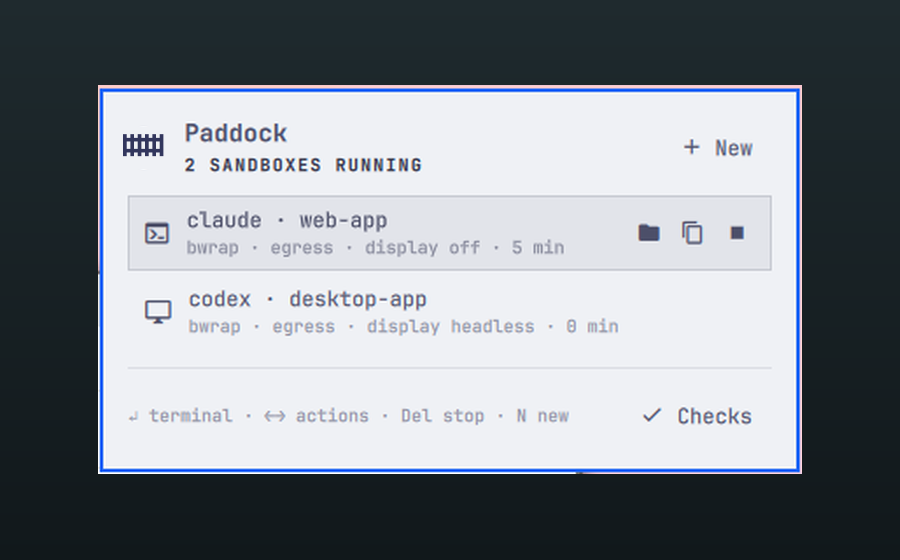

# Paddock for Omarchy

The Omarchy bar widget of [paddock](https://github.com/harnessix/paddock). paddock runs coding agents and desktop apps in sandboxes, on Linux and macOS. The widget shows the running sandboxes in the Omarchy bar, and lets you start, find and stop them and answer their host requests.



The paddock command itself, its documentation and its issues are in [harnessix/paddock](https://github.com/harnessix/paddock). This repository holds the widget and a pinned copy of paddock in `core/`, from which the Linux releases here are built.

## Install

1. Add the widget. It installs only the widget, not the `paddock` command:

   ```sh
   omarchy plugin add https://github.com/harnessix/omarchy-paddock --enable
   ```

2. Install the `paddock` command of the latest release, v0.2.1. With a Rust toolchain, clone the release tag and run the installer. On Arch Linux it builds and installs the package `omarchy-paddock` with makepkg:

   ```sh
   git clone --branch v0.2.1 https://github.com/harnessix/omarchy-paddock
   cd omarchy-paddock
   bin/install
   ```

   Without a Rust toolchain, use the prebuilt binary of the release:

   ```sh
   curl -fLO https://github.com/harnessix/omarchy-paddock/releases/download/v0.2.1/paddock-0.2.1-x86_64-linux.tar.gz
   curl -fLO https://github.com/harnessix/omarchy-paddock/releases/download/v0.2.1/paddock-0.2.1-x86_64-linux.tar.gz.sha256
   sha256sum -c paddock-0.2.1-x86_64-linux.tar.gz.sha256
   tar -xzf paddock-0.2.1-x86_64-linux.tar.gz
   install -m 755 paddock-0.2.1-x86_64-linux/paddock ~/.local/bin/paddock
   ```

   On a 64-bit Arm machine, use `aarch64` in place of `x86_64`.

3. Run `paddock setup`. It checks the system packages and offers the shell commands, the launchers and the default backend, one step at a time.

## What the widget does

- It lists the running sandboxes with their backend, network, display and login. Press Enter on a sandbox to go to the terminal that runs it.
- The row actions open the project folder, copy its path, show the display window of a sandbox, and stop the sandbox after a second press.
- The New button starts a sandbox: pick a recent project, then a harness that is installed on this machine.
- When an agent asks for something on the host, the widget turns red and shows the number of waiting requests. An approval card appears at the top of the screen.
- The Checks button runs `paddock doctor`. Every action has a key, and the panel footer lists them.

The [paddock documentation](https://github.com/harnessix/paddock#readme) describes each of these in full.

## Update

`paddock update` updates the command from the releases of this repository, and runs `omarchy plugin update harnessix.paddock --yes` for the widget. If you installed the Arch package, check out the new release tag in your clone and run `bin/install` again.

## Remove

```sh
omarchy plugin remove harnessix.paddock
```

To remove the `paddock` command too, follow [Remove](https://github.com/harnessix/paddock#remove) in the paddock documentation.

## This repository

- `plugin/` and `manifest.json` are the widget (QML).
- `core/` is an exact copy of a paddock release. `CORE` names its tag. If `core/` differs from that tag, CI fails. Do not edit it here: change paddock in [harnessix/paddock](https://github.com/harnessix/paddock).
- `bin/update-core vX.Y.Z` replaces `core/` with a newer release and sets the same version in `manifest.json`.
- A tag `vX.Y.Z` here builds the Linux binaries from `core/` and publishes them as a release of this repository.

paddock is released under the MIT license. See [LICENSE](LICENSE).
